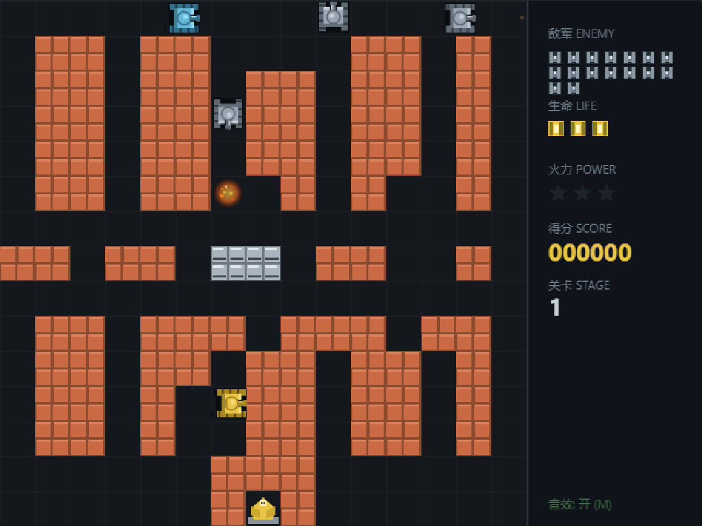

# 坦克大战 · Tank Battle

一个用纯 HTML5 Canvas 写的经典《坦克大战》（Battle City 风格）小游戏。
**单个 HTML 文件、零依赖、零构建**，双击打开就能玩。



## 玩法

| 操作 | 按键 |
| --- | --- |
| 移动 | `W` `A` `S` `D` 或 方向键 |
| 开火 | `空格` / `J` / `K` |
| 暂停 | `P` |
| 静音 | `M` |
| 重开 | `R` |

手机 / 平板会自动显示屏幕上的虚拟方向键和开火键。

### 规则

- 驾驶坦克消灭关卡内全部敌军即可过关，共 16 + 2×(关卡-1) 台。
- 屏幕右下角的**老鹰基地**是你的底线——基地被任何一方子弹击中，游戏立即结束。
- 每条命 3 条血量，阵亡后 3 秒护盾保护重生，火力等级掉一级。
- 敌军共四种：

  | 类型 | 特点 | 分值 |
  | --- | --- | --- |
  | 灰色 | 基础型，慢速 | 100 |
  | 蓝色 | 高速型，跑得快 | 200 |
  | 白色 | 火力型，子弹飞快 | 300 |
  | 装甲 | 绿→黄→橙→红，要打 4 下 | 400 |

- **红色闪烁的敌军**被击毁时会掉落道具，开过去吃掉即可生效：

  | 道具 | 效果 |
  | --- | --- |
  | ★ 火力星 | 火力 +1（满级 3 级：加速弹 → 双发 → 可击碎钢墙） |
  | 护盾 | 9 秒无敌 |
  | 加命 | 生命 +1 |
  | 清屏弹 | 立即摧毁场上全部敌军 |
  | 冻结钟 | 9 秒内敌军无法移动和射击 |
  | 铁锹 | 基地周围砖墙变钢墙，持续 16 秒 |

- 地形：**砖墙**可被击毁、**钢墙**只有 3 级火力能打穿、**河流**挡坦克但不挡子弹、**树林**可以藏坦克。

### 通关

内置 4 张手工设计的地图，循环使用；每循环一次，敌军数量、同屏上限和类型配比都会变强，
可以无限打下去。

## 运行

不需要任何服务器或依赖：

```bash
# 直接双击 index.html，或者
open index.html          # macOS
start index.html         # Windows
xdg-open index.html      # Linux
```

想用本地服务器也行：

```bash
python -m http.server 8000
# 然后访问 http://localhost:8000
```

## 实现说明

全部逻辑都在 `index.html` 一个文件里（约 1700 行），没有外部图片和音频：

- **画面**：所有精灵都用 Canvas 2D 路径即时绘制——坦克按方向旋转 90° 复用同一套画法，
  履带纹路随移动相位滚动；河流波纹用正弦随时间起伏。
- **音效**：WebAudio 振荡器 + 白噪声实时合成，没有音频文件。
- **移动手感**：转向时把垂直轴对齐到 32px 格线，避免卡在墙角；
  推进按 4px 分小步做碰撞检测，高速子弹也不会穿墙。
- **AI**：敌军 60% 概率朝玩家或基地方向推进，其余随机；
  与目标在一条线上时会高概率立刻开火。

## 浏览器支持

任何支持 Canvas 2D 和 ES6 class 的现代浏览器：Chrome / Edge / Firefox / Safari 均可。

## 许可

MIT
